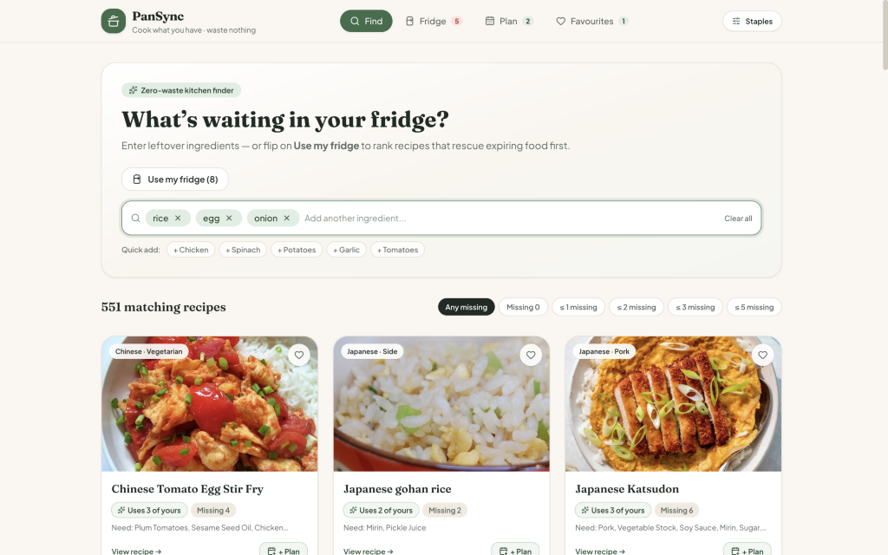
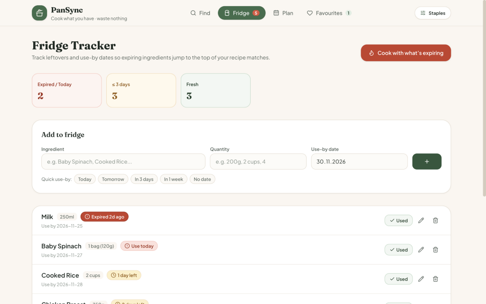
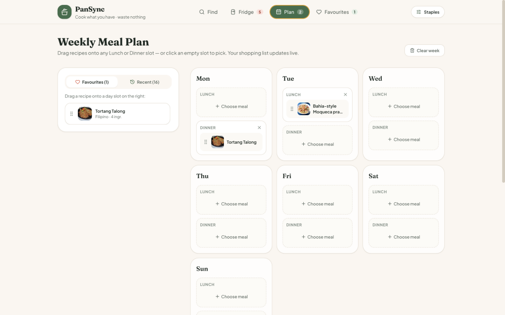
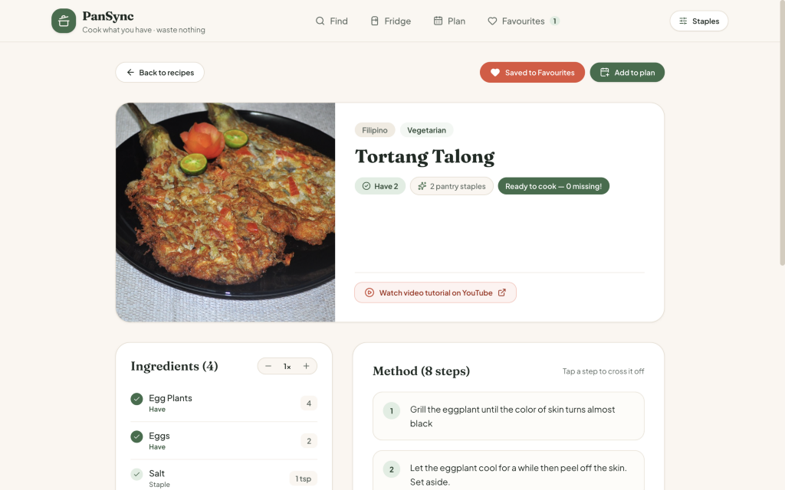
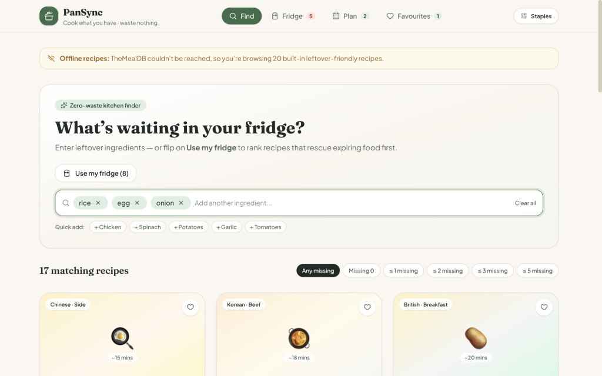

# PanSync — Cook What You Have, Waste Nothing

PanSync is a client-side zero-waste kitchen companion built for portfolio reliability: enter leftover ingredients in your fridge to get ranked recipes that use them up, track use-by dates so expiring items rise to the top, plan Monday–Sunday lunches and dinners via drag-and-drop, and generate a merged shopping list that automatically subtracts your fridge and pantry staples.

No sign-up, no backend, and no secret API keys required — with automatic IndexedDB caching and a built-in 20-recipe offline fallback collection so the app works every time.

---

## Screenshots

### Leftovers → Ranked Recipes (`Find`)


### Fridge Tracker & Expiry Badges (`Fridge`)


### Drag-and-Drop Weekly Planner (`Plan`)


### Recipe Detail with Have / Staple / Missing Ticks & Portion Scaler


### Offline Fallback Mode (`/?offline=1` or Unreachable Network)


---

## Key Features

- **Leftovers → Recipes Finder (`/`)**:
  - Multi-chip ingredient input with keyboard autocomplete, comma-separated entry (`rice, egg, onion`), and quick-add leftover chips.
  - **"Use my fridge" expiry mode**: pulls tracked fridge items and boosts recipes that rescue expiring ingredients first.
  - **"Missing at most N"** filter (`Missing 0`, `≤ 1`, `≤ 2`, `≤ 3`, `≤ 5`) plus a first-visit **"Try sample fridge"** onboarding state.
- **Smart Ingredient Matching (`src/lib/matching.ts`)**:
  - Normalizes casing, punctuation, plurals (`tomatoes → tomato`, `berries → berry`, `zucchinis → zucchini`), leftover prefixes (`cooked rice → rice`), and UK/US culinary aliases (`scallion ↔ spring onion`, `aubergine ↔ eggplant`, `courgette ↔ zucchini`, `minced beef ↔ ground beef`).
  - Whole-word matching (`chicken` matches `Chicken Breast`) with culinary compound guards so `egg` never false-matches `Eggplant` / `Egg Noodles`, `rice` never false-matches `Rice Vinegar`, and `pepper` staple never false-matches `Red Bell Pepper`.
- **Recipe Detail (`/recipe/:id`)**:
  - Ticks off **Have** and **Pantry Staple** ingredients, flags **Missing** items (with one-click *"I have this"* fridge add), scales ingredient portions (`0.5×`–`4×`), crosses off cooking steps interactively, links to YouTube tutorials, saves to **Favourites**, and assigns directly to any weekly meal slot.
- **Fridge Tracker (`/fridge`)**:
  - Tracks quantities and use-by dates with colour-coded badges (**Expired**, **Use today**, **≤ 3 days**, **Fresh**), inline editing, *"Used"* quick completion, and a **"Cook with what's expiring"** shortcut.
- **Weekly Meal Plan & Smart Shopping List (`/plan`)**:
  - Monday–Sunday **Lunch** and **Dinner** slots powered by `@dnd-kit/core` drag-and-drop from Favourites and Recent matches (plus click-to-choose modal).
  - Automatically merges duplicate ingredients and numeric quantities across planned meals (`200g + 300g → 500g`), removes everything already in your **Fridge** or **Pantry Staples**, persists checkboxes, and copies cleanly to the clipboard.
- **Pantry Staples & Dietary Exclusions**:
  - Manage custom pantry staples (`salt`, `pepper`, `oil`, `water` by default) and allergen/disliked-ingredient exclusions from the top **Staples** modal.
- **Resilient Data Layer (`src/data/mealdb.ts`)**:
  - Fetches the full TheMealDB index (`a`–`z` in parallel) and ingredient directory on first visit, caching both in IndexedDB (`idb-keyval`) for 7 days so subsequent searches run locally in `< 5ms` with zero network calls.
  - Falls back to 20 original leftover-friendly recipes (`src/data/fallback-recipes.json`) with emoji/gradient cards and an offline status banner whenever TheMealDB is unreachable (previewable anytime at `/?offline=1`).

---

## Tech Stack

- **UI & Routing**: Vite, React 19, TypeScript, React Router v7, Tailwind CSS v4, Lucide Icons
- **State & Storage**: Zustand (`persist` in `localStorage`) + `idb-keyval` (`IndexedDB`)
- **Drag & Drop**: `@dnd-kit/core` & `@dnd-kit/utilities`
- **Testing & Quality**: Vitest, React Testing Library, `fake-indexeddb`, `oxlint`

---

## Getting Started

```bash
# Install dependencies
npm install

# Start local dev server on http://127.0.0.1:5173
npm run dev

# Run unit, store, caching, and end-to-end flow tests
npm test

# Lint and build static production bundle (dist/)
npm run lint
npm run build
```

### Deploying to Vercel

PanSync compiles to a pure static bundle (`dist/`) with SPA deep-link rewrites preconfigured in [`vercel.json`](./vercel.json) — zero environment variables required.
